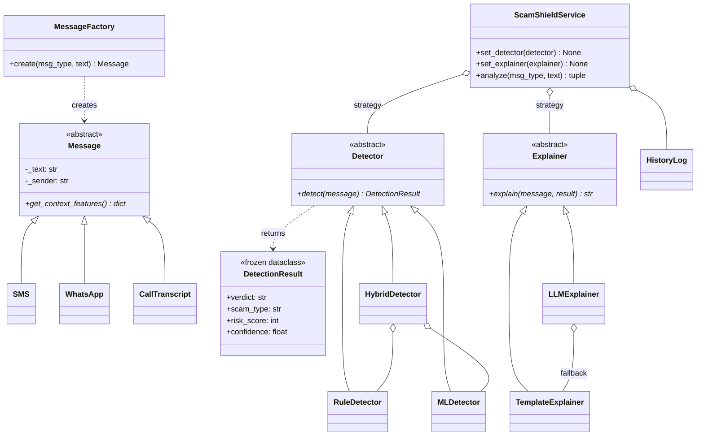
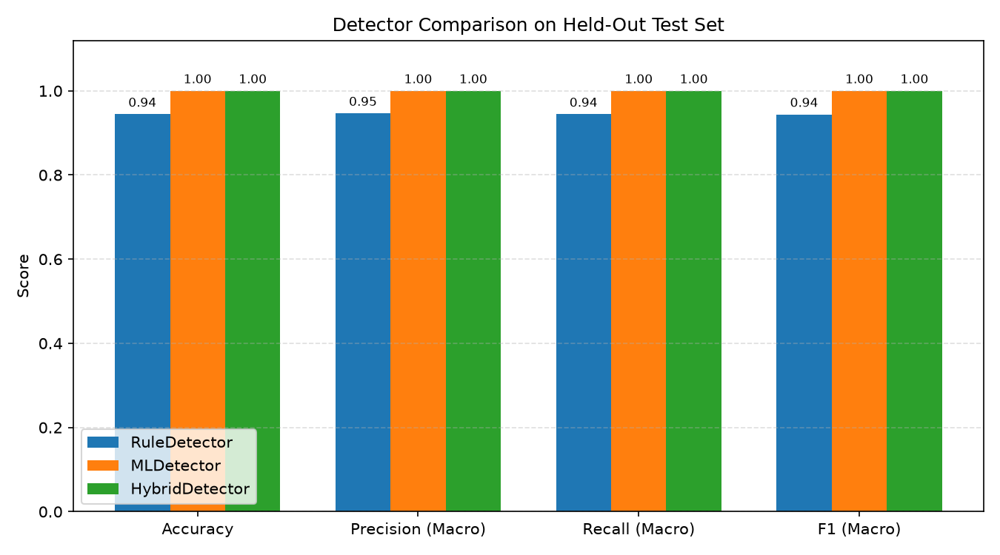
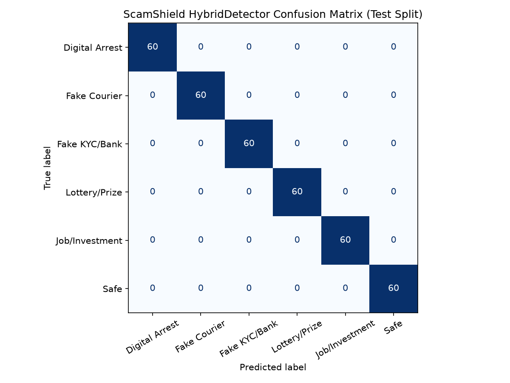

<div align="center">

# 🛡️ ScamShield — Indian Scam Message & Call Transcript Detector

**AI + Object-Oriented Python system for detecting SMS, WhatsApp, and phone/video call scams in English, Hinglish, and mixed text.**


</div>

---

## 📖 Overview

**ScamShield** helps users in India quickly check whether a suspicious **SMS**, **WhatsApp message**, or **phone/video call transcript** is a **SCAM** or **SAFE**. For every check, it outputs:

- **Verdict:** `SCAM` or `SAFE`
- **Risk Score:** `0–100`
- **Scam Category:** One of 6 classes:
  1. **Digital Arrest** (fake CBI / NCB / TRAI / Cyber Crime video-call threats)
  2. **Fake Courier** (spoofed FedEx / DHL / India Post / customs seizure notices)
  3. **Fake KYC/Bank** (expired KYC / PAN / blocked account / OTP & AnyDesk scams)
  4. **Lottery/Prize** (fake KBC / lucky draw / upfront processing fee scams)
  5. **Job/Investment** (Telegram like/subscribe tasks & guaranteed-return schemes)
  6. **Safe** (legitimate personal, banking alert, OTP-warning, and service messages)
- **Plain-English Explanation:** Why the message was flagged (triggered rules + AI-detected indicator phrases) and an actionable safety tip.

This project is designed for both **Object-Oriented Programming (OOP)** and **Artificial Intelligence (AI)** coursework, combining clean software architecture with a trained multi-class NLP pipeline.

---

## ✨ Key Features

- **Hybrid AI + Heuristic Engine:** Combines a TF-IDF (word + character n-grams) + `LogisticRegression` classifier (`MLDetector`) with 16 curated Indian fraud rules (`RuleDetector`) via `HybridDetector` (`0.6 × ML + 0.4 × Rules`).
- **English, Hinglish & Mixed Support:** Handles real-world Indian phrasing such as *"turant KYC update karo"*, *"aapka parcel customs me ruka hai"*, and *"digital arrest verification"*, alongside typos, mixed casing, and emojis.
- **Channel-Aware Context:** `SMS`, `WhatsApp`, and `CallTranscript` models extract channel-specific signals (DLT headers, Telegram/WhatsApp group links, speaker turns, video-call pressure).
- **100% Offline-First Explanations (+ Optional LLM):** `TemplateExplainer` works completely offline with zero paid APIs. If `ANTHROPIC_API_KEY` is set, `LLMExplainer` calls Anthropic Claude and automatically falls back to `TemplateExplainer` on any error.
- **Interactive Streamlit Web App:** Includes a risk meter, 5 one-click sample scam messages, runtime detector strategy switcher, safety tips, and persistent CSV check history (`data/history.csv`).

---

## 🏗️ OOP Architecture & Design

ScamShield is structured around clean abstractions, composition, and classic design patterns. Full details are documented in [`docs/oop_concepts.md`](docs/oop_concepts.md) and [`docs/uml_class_diagram.md`](docs/uml_class_diagram.md).



### OOP Concepts Mapping

| OOP Concept | Implementation | Purpose |
|---|---|---|
| **Abstraction** | `Detector` (`scamshield/detectors/base.py`), `Explainer` (`scamshield/explain/explainer.py`), `Message` (`scamshield/models/message.py`) | `abc.ABC` interfaces with `@abstractmethod` contracts (`detect`, `explain`, `get_context_features`). |
| **Inheritance** | `SMS`, `WhatsApp`, `CallTranscript` → `Message`; `RuleDetector`, `MLDetector`, `HybridDetector` → `Detector`; `TemplateExplainer`, `LLMExplainer` → `Explainer` | Shared base validation/helpers with specialized channel and detector behavior. |
| **Polymorphism** | `ScamShieldService.analyze()` calls `detect()` and `explain()` uniformly; `Message` subclasses override `get_context_features()` | Swap detectors, explainers, or message channels without changing service code. |
| **Encapsulation** | Private `_` attributes with `@property` accessors; `@dataclass(frozen=True) DetectionResult` | Protects internal state, validates inputs, and guarantees immutable detection results. |
| **Composition** | `HybridDetector` has `MLDetector` + `RuleDetector`; `ScamShieldService` has `Detector` + `Explainer` + `HistoryLog`; `LLMExplainer` has `TemplateExplainer` | Builds complex pipelines by combining focused, replaceable components. |
| **Strategy Pattern** | `ScamShieldService.set_detector()` & `set_explainer()` | Lets the UI and evaluation scripts switch between Rule, ML, and Hybrid detectors at runtime. |
| **Factory Pattern** | `MessageFactory.create(msg_type, text, **kwargs)` | Centralizes creation of `SMS`, `WhatsApp`, and `CallTranscript` instances. |
| **Custom Exceptions** | `EmptyMessageError`, `ModelNotTrainedError`, `InvalidMessageTypeError` (`scamshield/exceptions.py`) | Explicit domain error handling across validation, ML inference, and factory calls. |

---

## 🤖 AI Pipeline & Evaluation

### 1. Dataset (`data/generate_dataset.py`)
- Generates **1,800 balanced messages** (**300 per class** across all 6 categories) saved to [`data/messages.csv`](data/messages.csv).
- Uses varied **English, Hinglish, and mixed** templates with randomized Indian names, bank/courier brands, `₹`/`Rs.`/`INR` amounts, `+91` phone numbers, tracking IDs, and suspicious URLs.
- Injects realistic noise (typos, uppercase emphasis, emojis) and optionally incorporates benign `ham` messages if `data/SMSSpamCollection` is present locally.

### 2. Preprocessing & Models
- **`TextCleaner` (`scamshield/preprocess.py`):** Normalizes URLs (`__url__`), phone numbers (`__phone__`), and currency amounts (`__money__`), collapses repeated characters, and cleans punctuation/whitespace.
- **`MLDetector` (`scamshield/detectors/ml.py`):** `FeatureUnion` of word TF-IDF (`ngram_range=(1, 2)`) and character `char_wb` TF-IDF (`ngram_range=(3, 5)`) fed into `LogisticRegression(class_weight="balanced")`.
- **Training (`train.py`):** 80/20 stratified split (`1,440` train / `360` held-out test) with **5-fold stratified cross-validation**:
  - **5-Fold CV Accuracy:** `1.0000`
  - **5-Fold CV Macro-F1:** `1.0000`

### 3. Held-Out Test Set Benchmark (`evaluate.py`)
Evaluated on the untouched **360-message (20%)** stratified test split ([`results/metrics.json`](results/metrics.json)):

| Detector | Accuracy | Precision (Macro) | Recall (Macro) | F1 (Macro) | Binary Accuracy (Scam vs Safe) |
|---|---:|---:|---:|---:|---:|
| **RuleDetector** | 0.9444 | 0.9466 | 0.9444 | 0.9440 | 0.9778 |
| **MLDetector** | 1.0000 | 1.0000 | 1.0000 | 1.0000 | 1.0000 |
| **HybridDetector** | 1.0000 | 1.0000 | 1.0000 | 1.0000 | 1.0000 |

<p align="center">
  
  
</p>

---

## 📁 Project Structure

```text
ScamShield/
├── app.py                        # Streamlit web interface
├── train.py                      # 80/20 stratified split, 5-fold CV, model export
├── evaluate.py                   # Rule vs ML vs Hybrid benchmark + charts
├── requirements.txt              # Pinned Python dependencies
├── .gitignore                    # Ignores caches, venvs, and runtime history.csv
├── README.md                     # Project documentation
├── data/
│   ├── generate_dataset.py       # Synthetic English/Hinglish dataset generator
│   └── messages.csv              # 1,800 labeled messages (300 per class)
├── models_artifacts/
│   └── ml_detector.joblib        # Saved TF-IDF + LogisticRegression pipeline
├── scamshield/
│   ├── __init__.py               # Public package exports
│   ├── exceptions.py             # Custom exception hierarchy
│   ├── preprocess.py             # TextCleaner
│   ├── history.py                # HistoryLog (CSV check logger)
│   ├── service.py                # ScamShieldService (Facade + Strategy)
│   ├── models/
│   │   ├── __init__.py
│   │   └── message.py            # Message, SMS, WhatsApp, CallTranscript, Factory, DetectionResult
│   ├── detectors/
│   │   ├── __init__.py
│   │   ├── base.py               # Detector (ABC)
│   │   ├── rule.py               # RuleDetector (16 weighted rules)
│   │   ├── ml.py                 # MLDetector (TF-IDF + LogisticRegression)
│   │   └── hybrid.py             # HybridDetector (0.6 ML + 0.4 Rules)
│   └── explain/
│       ├── __init__.py
│       └── explainer.py          # Explainer (ABC), TemplateExplainer, LLMExplainer
├── tests/
│   └── test_scamshield.py        # 21 pytest unit & integration tests
├── results/
│   ├── metrics.json              # Evaluation metrics JSON
│   ├── comparison.png            # Detector comparison bar chart
│   ├── confusion_matrix.png      # HybridDetector confusion matrix
│   └── misclassified.txt         # Misclassified sample log
└── docs/
    ├── oop_concepts.md           # OOP concept-to-code mapping
    └── uml_class_diagram.md      # Mermaid UML class diagram
```

---

## 🚀 Quick Start (Local)

```bash
# 1. Install dependencies
pip install -r requirements.txt

# 2. Generate the dataset (1,800 messages)
python data/generate_dataset.py

# 3. Train the ML model (80/20 split + 5-fold CV)
python train.py

# 4. Evaluate Rule vs ML vs Hybrid detectors
python evaluate.py

# 5. Run the test suite (21 tests)
pytest -v

# 6. Launch the Streamlit app
streamlit run app.py
```

*(Optional)* To enable Anthropic-powered explanations, set `ANTHROPIC_API_KEY` in your environment before running Streamlit. Without it, ScamShield runs 100% offline using `TemplateExplainer`.

---

## ☁️ Deploying to Streamlit Community Cloud

Because `models_artifacts/ml_detector.joblib` is included in the repository, deployment works out of the box:

1. Push this repository to GitHub (`main` branch).
2. Sign in at [share.streamlit.io](https://share.streamlit.io) with GitHub and click **New app**.
3. Set **Main file path** to `app.py` and select your repository and `main` branch.
4. *(Optional)* Under **Advanced settings → Secrets**, add `ANTHROPIC_API_KEY = "your-key"`.
5. Click **Deploy!**.

---

## ⚠️ Disclaimer & Dataset Note

> **Academic & Synthetic Data Notice:** The training and evaluation dataset (`data/messages.csv`) is **synthetically generated** from English and Hinglish templates with randomized entities and noise. Because synthetic templates share structural patterns, benchmark accuracy (`1.0000` for ML/Hybrid) will be higher than on unseen real-world messages. ScamShield is an academic tool and can make mistakes—always verify suspicious messages through official channels or report cyber fraud in India by calling **1930** or visiting [cybercrime.gov.in](https://cybercrime.gov.in).
